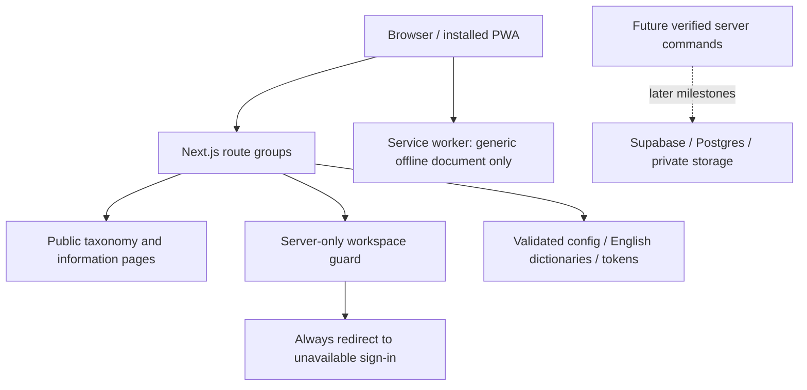

# Milestone 00 architecture

A modular monolith: one Next.js App Router application, public server-rendered pages with a small interactive navigation/PWA boundary. No business mutation or persistence exists yet.

## Current boundaries

- `src/app/(public)`: home, service taxonomy, category notices, explore notice and informational/legal preview pages. All category content comes from the confirmed PRD, not inventory.
- `src/app/(auth)`: truthful signed-out shell with no form, OTP request or self-signup.
- `src/app/(app)`: client and worker route boundaries. `src/app/(admin)`: separate administrator boundary. Every route denies access. No role selector is an authority.
- `src/features/auth`: server-only identity/guard modules, deliberately always denying. `src/features/services`: public taxonomy and presentation.
- `src/config`: public brand/environment contract, server-only flag/environment validation. Server startup and server rendering validate it.
- `src/lib/supabase`: unused publishable-key browser and read-only cookie adapters. No privileged key client or schema exposure. M02 must implement supported SSR refresh before use.
- `src/components/ui`: shadcn source generated with CLI then adapted to local utilities, Radix Slot, pill radii and 44px default targets. No umbrella Radix or duplicate class utility dependency.
- `src/locales`: English plus honest language fallbacks. Locale does not affect authorization.
- `tests/e2e`: production-server checks, forged-session denials, public navigation, a11y, PWA/cache checks. Security boundary and config tests live beside their domains or under `tests/security`.

Future modules follow the PRD directory layout and are added when their milestones begin, not as empty services or permissive mock APIs. Domain interfaces must minimize public DTOs and keep SQL, identity and provider adapters in server-only files. `server-only` provides a compiler guard; the lint command also traverses local client imports. The conservative graph script is an additional check, not a complete JavaScript security analyzer.

## Data / commands / routes

The two root SQL files remain untouched and unexecuted. `docs/schema.md`, `docs/permissions.md`, `docs/states.md` and `docs/API.md` point to their controlling references and mark unimplemented boundaries. There is no exposed categories API; public taxonomy currently renders server-side. No webhooks or internal scheduler endpoints exist.

## Rollback

Revert the foundation PR to the preserved build-pack commit. No migration, provider account or deployed resource needs rollback. Browser data contains only an offline document; unregister the service worker and clear its cache via browser site-data controls when testing a rollback. Do not deploy the SQL blueprints.

## Milestone 01 extension

The local database baseline is now in `supabase/`, with pinned CLI, local-only scripts, reviewed migrations, synthetic non-login fixtures and pgTAP checks. See ADR 0002. It is not connected to the deployed foundation. Full runtime verification and infrastructure limitations are recorded in milestone-specific evidence; the original SQL blueprints remain reference-only.
