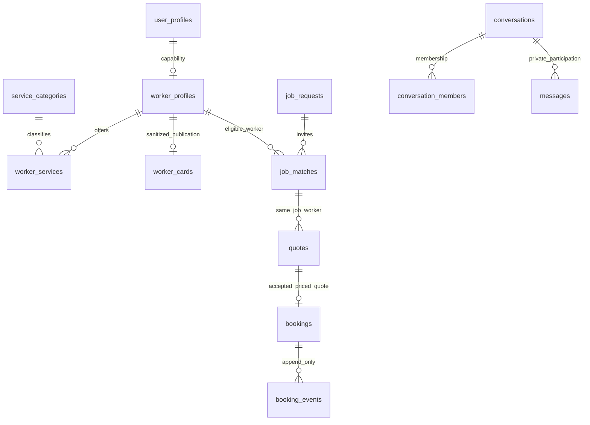

# Reviewed local schema — Milestone 01

The root SQL blueprints remain untouched references. `supabase/migrations/20261031114309_foundation.sql` is the fresh CLI-created, reviewed baseline. Runtime verification is recorded in `docs/evidence/milestone-01.md`; do not infer a hosted database exists.

`auth.users` IDs are the common identity root. With Auth disabled, the local Supabase CLI initializes an ID-only Auth baseline; fixture identities cannot log in. Public business/worker/profile tables have owner-only read policies; guest discovery reads the published sanitized card and only the service categories on that card.

Private tables cover client addresses, exact job locations, worker coverage, business registration, verifications/documents, inspection grants, admin membership, actor-bound command-idempotency records, payment intents/ledger/provider events/payout accounts, notification outbox and audit. Private schema usage is denied to browser roles and excluded from API exposure/search path. PostGIS is installed in `extensions`; geography GIST indexes use metres and longitude before latitude.

The schema represents future domains but does not implement their commands. Storage service/buckets are disabled until milestone 03. No API publishes fixture identities or rows. Server command authorization, actor verification/MFA, transactions and idempotent execution remain prerequisites before enabling domain actions.
